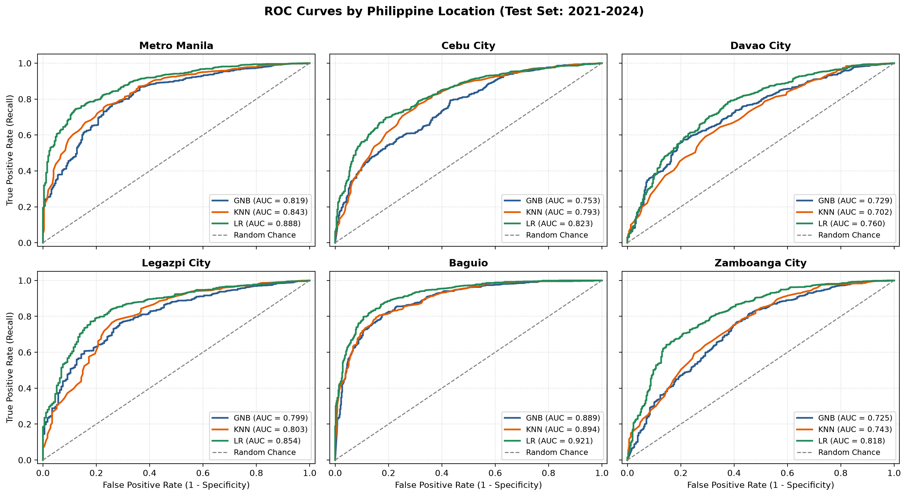
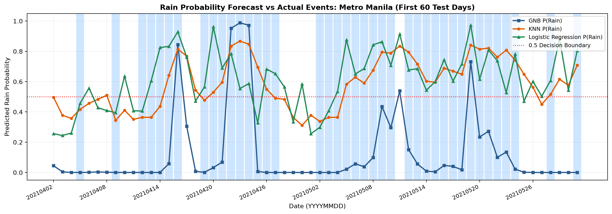

# Next Day Weather Predcition in the Philippines

## Group BAWWL

### Problem

Can we predict whether it will rain the next day (more than 1 mm) at selected locations across the Philippines, using the past 5 days of weather data?

### Dataset

[NASA Power Dataset (Energy Resources)](https://power.larc.nasa.gov/data-access-viewer/)

|                   Parameter                   |                       What it does                        |
| :-------------------------------------------: | :-------------------------------------------------------: |
|            Temperature at 2 meters            |    Average air temperature; primary weather indicator     |
|        Maximum temperature at 2 meters        |                   Captures daytime heat                   |
|        Minimum temperature at 2 meters        |                Captures nighttime cooling                 |
|            Corrected precipitation            |       Daily rainfall; essential for rain prediction       |
|         Relative humidity at 2 meters         |               Measures atmospheric moisture               |
|               Surface pressure                |      Helps identify changing atmospheric conditions       |
|            Wind speed at 10 meters            |                  Measures wind strength                   |
|          Wind direction at 10 meters          |      Captures wind patterns and seasonal circulation      |
|             Dew point at 2 meters             | Indicates atmospheric moisture and potential condensation |
| All-sky surface shortwave downward irradiance |    Measures incoming solar energy, affected by clouds     |

### Methods

1. Logisitc Regression - a simple and interpretable baseline model that estimates the probability of rainfall from weather features.
2. K-Nearest Neighbors - predicts rain by finding the past days whose recent weather looks most like the last `n` days and classifying them.
3. Gaussian Naive Bayes - calculates the likelihood of observing today's weather readings under "Rain" versus "Dry" conditions.

### Setup

The NASA Power Dataset is split chronologically as follows: 70% train, 15% validation, and 15% test split.

### Results

```bash
=================================================================
CMSC 170 - Group BAWWL: Weather Pipeline
=================================================================

Processing Metro Manila...
Loaded 9132 daily records for 'Metro Manila' from c:\Users\orij\School\3Y1S\170\CMSC-170-Project\data\raw\metro_manila.csv
  Train: 6388 samples | Val: 1369 | Test: 1370
  Features per sample: 55 (5 days x 11 daily features)

Processing Cebu City...
Loaded 9132 daily records for 'Cebu City' from c:\Users\orij\School\3Y1S\170\CMSC-170-Project\data\raw\cebu.csv
  Train: 6388 samples | Val: 1369 | Test: 1370
  Features per sample: 55 (5 days x 11 daily features)

Processing Davao City...
Loaded 9132 daily records for 'Davao City' from c:\Users\orij\School\3Y1S\170\CMSC-170-Project\data\raw\davao.csv
  Train: 6388 samples | Val: 1369 | Test: 1370
  Features per sample: 55 (5 days x 11 daily features)

Processing Legazpi City...
Loaded 9132 daily records for 'Legazpi City' from c:\Users\orij\School\3Y1S\170\CMSC-170-Project\data\raw\legazpi.csv
  Train: 6388 samples | Val: 1369 | Test: 1370
  Features per sample: 55 (5 days x 11 daily features)

Processing Baguio...
Loaded 9132 daily records for 'Baguio' from c:\Users\orij\School\3Y1S\170\CMSC-170-Project\data\raw\baguio.csv
  Train: 6388 samples | Val: 1369 | Test: 1370
  Features per sample: 55 (5 days x 11 daily features)

Processing Zamboanga City...
Loaded 9132 daily records for 'Zamboanga City' from c:\Users\orij\School\3Y1S\170\CMSC-170-Project\data\raw\zamboanga_city.csv
  Train: 6388 samples | Val: 1369 | Test: 1370
  Features per sample: 55 (5 days x 11 daily features)

=================================================================
Preprocessing Summary (Ready for Model Training)
=================================================================
- Metro Manila    : 6388 train | 1370 test | Train Rain:  76.0%
- Cebu City       : 6388 train | 1370 test | Train Rain:  68.3%
- Davao City      : 6388 train | 1370 test | Train Rain:  70.2%
- Legazpi City    : 6388 train | 1370 test | Train Rain:  75.3%
- Baguio          : 6388 train | 1370 test | Train Rain:  56.9%
- Zamboanga City  : 6388 train | 1370 test | Train Rain:  74.5%

==============================================================================
Gaussian Naive Bayes: initial results (VALIDATION set)
==============================================================================

[1] Learned priors (index 0 = Dry, 1 = Rain)
  Metro Manila     P(Dry)=0.240  P(Rain)=0.760
  Cebu City        P(Dry)=0.317  P(Rain)=0.683
  Davao City       P(Dry)=0.298  P(Rain)=0.702
  Legazpi City     P(Dry)=0.247  P(Rain)=0.753
  Baguio           P(Dry)=0.431  P(Rain)=0.569
  Zamboanga City   P(Dry)=0.255  P(Rain)=0.745

[2] Sample predictions, Metro Manila (first 10 validation days)
  Day  P(rain)  Pred@0.5  Actual
    0    0.998         1       1
    1    1.000         1       1
    2    1.000         1       1
    3    1.000         1       1
    4    1.000         1       1
    5    1.000         1       1
    6    1.000         1       1
    7    1.000         1       1
    8    1.000         1       1
    9    1.000         1       1

[3] Metrics (threshold tuned on validation F1)
  Location           Thr     F1   Prec    Rec    Acc    AUC | AlwaysRain F1 AlwaysRain Acc
  Metro Manila      0.02  0.855  0.877  0.833  0.774  0.760 |         0.888          0.798
  Cebu City         0.02  0.826  0.777  0.882  0.736  0.719 |         0.830          0.710
  Davao City        0.02  0.841  0.791  0.896  0.753  0.755 |         0.842          0.727
  Legazpi City      0.02  0.865  0.892  0.839  0.785  0.788 |         0.901          0.820
  Baguio            0.02  0.854  0.874  0.835  0.818  0.870 |         0.778          0.637
  Zamboanga City    0.02  0.817  0.804  0.830  0.744  0.769 |         0.814          0.686

[4] Confusion matrix counts
  Location            TP    FP    TN    FN
  Metro Manila       911   128   148   182
  Cebu City          857   246   151   115
  Davao City         892   235   139   103
  Legazpi City       942   114   132   181
  Baguio             728   105   392   144
  Zamboanga City     779   190   240   160
K-nearest neighbour output
k-value:  15     p-value:  2
Metro Manila train: 6388 -> test: 1370
Cebu City train: 6388 -> test: 1370
Davao City train: 6388 -> test: 1370
Legazpi City train: 6388 -> test: 1370
Baguio train: 6388 -> test: 1370
Zamboanga City train: 6388 -> test: 1370

Metro Manila
  Confusion matrix [[TN FP] [FN TP]]: [[107, 144], [66, 1053]]
  Accuracy : 0.8467
  Precision: 0.8797
  Recall   : 0.941
  F1-score : 0.9093

Cebu City
  Confusion matrix [[TN FP] [FN TP]]: [[148, 228], [75, 919]]
  Accuracy : 0.7788
  Precision: 0.8012
  Recall   : 0.9245
  F1-score : 0.8585

Davao City
  Confusion matrix [[TN FP] [FN TP]]: [[74, 237], [102, 957]]
  Accuracy : 0.7526
  Precision: 0.8015
  Recall   : 0.9037
  F1-score : 0.8495

Legazpi City
  Confusion matrix [[TN FP] [FN TP]]: [[56, 118], [62, 1134]]
  Accuracy : 0.8686
  Precision: 0.9058
  Recall   : 0.9482
  F1-score : 0.9265

Baguio
  Confusion matrix [[TN FP] [FN TP]]: [[371, 120], [148, 731]]
  Accuracy : 0.8044
  Precision: 0.859
  Recall   : 0.8316
  F1-score : 0.8451

Zamboanga City
  Confusion matrix [[TN FP] [FN TP]]: [[75, 233], [48, 1014]]
  Accuracy : 0.7949
  Precision: 0.8132
  Recall   : 0.9548
  F1-score : 0.8783

OVERALL
  Confusion matrix [[TN FP] [FN TP]]: [[831, 1080], [501, 5808]]
  Accuracy : 0.8077
  Precision: 0.8432
  Recall   : 0.9206
  F1-score : 0.8802

==============================================================================
Logistic Regression
==============================================================================

[1] Sample predictions, Metro Manila (first 10 validation days)
  Day  P(rain)  Pred@0.5  Actual
    0    0.882         1       1
    1    0.976         1       1
    2    0.987         1       1
    3    0.909         1       1
    4    0.910         1       1
    5    0.950         1       1
    6    0.960         1       1
    7    0.947         1       1
    8    0.965         1       1
    9    0.989         1       1

[2] Metrics (threshold tuned on validation F1)
  Location           Thr     F1   Prec    Rec    Acc    AUC | AlwaysRain F1 AlwaysRain Acc
  Metro Manila      0.38  0.902  0.840  0.973  0.831  0.827 |         0.888          0.798
  Cebu City         0.46  0.851  0.779  0.938  0.767  0.796 |         0.830          0.710
  Davao City        0.38  0.865  0.791  0.956  0.784  0.793 |         0.842          0.727
  Legazpi City      0.30  0.912  0.850  0.984  0.844  0.843 |         0.901          0.820
  Baguio            0.42  0.881  0.868  0.894  0.846  0.908 |         0.778          0.637
  Zamboanga City    0.40  0.856  0.776  0.954  0.780  0.816 |         0.814          0.686

[3] Confusion matrix counts
  Location            TP    FP    TN    FN
  Metro Manila      1063   202    74    30
  Cebu City          912   259   138    60
  Davao City         951   252   122    44
  Legazpi City      1105   195    51    18
  Baguio             780   119   378    92
  Zamboanga City     896   258   172    43

=================================================================
Generating Matplotlib Visualizations...
=================================================================
[Plot saved] ROC curves saved to: c:\Users\orij\School\3Y1S\170\CMSC-170-Project\figures\roc_curves_by_location.png
[Plot saved] Metrics comparison saved to: c:\Users\orij\School\3Y1S\170\CMSC-170-Project\figures\metrics_comparison.png
[Plot saved] Calibration curves saved to: c:\Users\orij\School\3Y1S\170\CMSC-170-Project\figures\calibration_curves.png
[Plot saved] Sample timeseries saved to: c:\Users\orij\School\3Y1S\170\CMSC-170-Project\figures\timeseries_metro_manila.png
All figures generated successfully in: c:\Users\orij\School\3Y1S\170\CMSC-170-Project\figures
```







### Discussion

### Conclusion

### References

- Patkar, U., Maske, S., Ahmad, S., Mengade, R., & Sadawarti, G. (2021). Weather prediction using machine learning. GIS Science Journal, 8(12), 118-125. [https\://www\.researchgate.net/publication/362517661_WEATHER_PREDICTION_USING_MACHINE_LEARNING](https://www.researchgate.net/publication/362517661_WEATHER_PREDICTION_USING_MACHINE_LEARNING)

- Powers, D. M. W. (2011). Evaluation: From precision, recall and F-measure to ROC, informedness, markedness and correlation. _Journal of Machine Learning Technologies_, _2_(1), 37–63. [https\://www\.researchgate.net/publication/228529307](https://www.researchgate.net/publication/228529307)

- J. I. N. Gojo Cruz, “Lab 04: Naïve Bayes Classifier,” laboratory handout, \[Institute of Computer Science, University of the Philippines Los Baños\], 2026\.

- "Unfolding Naive Bayes from scratch: Part 2," Data Science Dojo. Accessed: Nov. 3, 2026\. \[Online\]. Available: [https\://datasciencedojo.com/blog/naive-bayes-from-scratch-part-2/](https://datasciencedojo.com/blog/naive-bayes-from-scratch-part-2/)

- S. Baladram, "Gaussian Naive Bayes, explained: A visual guide with code examples for beginners," Towards Data Science, Oct. 11, 2024\. Accessed: Nov. 3, 2026\. \[Online\]. Available: [https\://towardsdatascience.com/gaussian-naive-bayes-explained-a-visual-guide-with-code-examples-for-beginners-04949cef383c](https://towardsdatascience.com/gaussian-naive-bayes-explained-a-visual-guide-with-code-examples-for-beginners-04949cef383c)

- F. Lee, "What is logistic regression?," IBM, May 14, 2025. [Online]. Available: https://www.ibm.com/think/topics/logistic-regression. [Accessed: Nov. 10, 2026].

- "Logistic regression in machine learning," GeeksforGeeks, Jun. 1, 2026. [Online]. Available: https://www.geeksforgeeks.org/machine-learning/understanding-logistic-regression/. [Accessed: Nov. 10, 2026].
