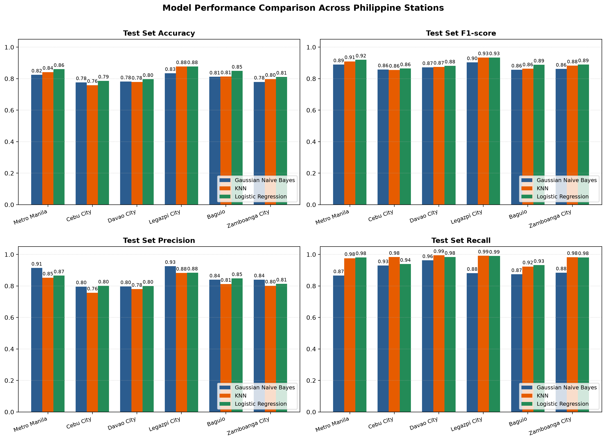
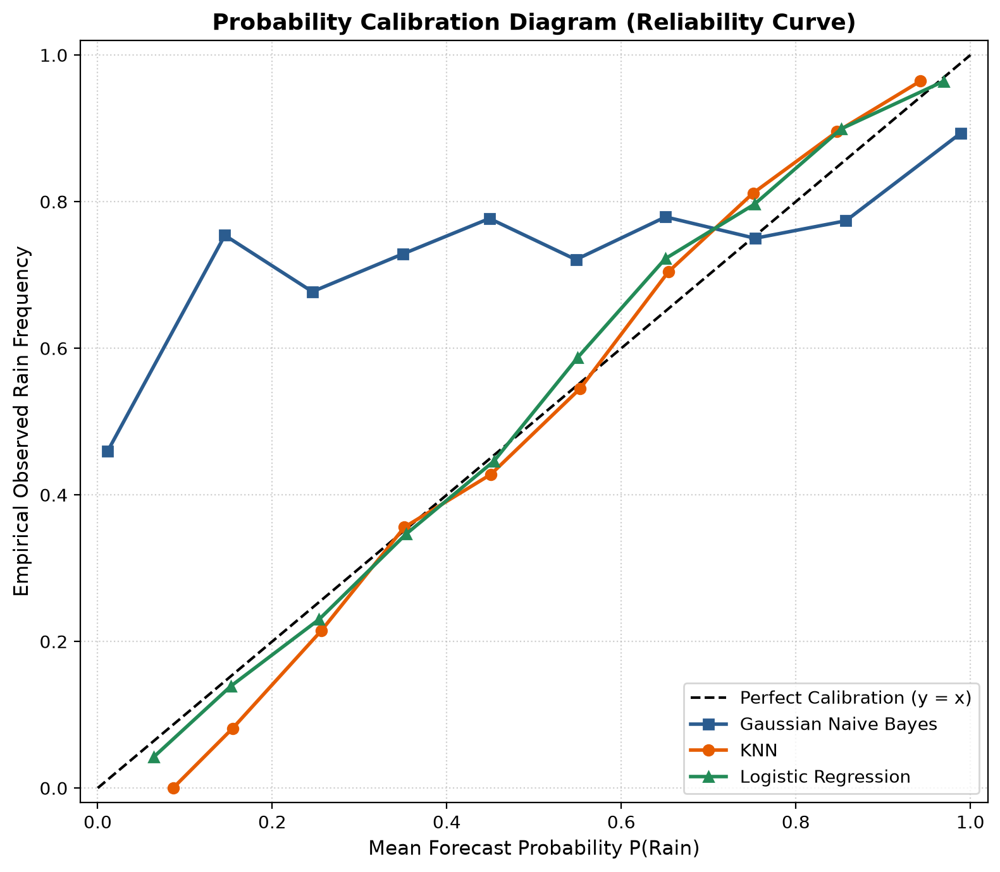

# Next-Day Rainfall Prediction in the Philippines

**CMSC 170 · Group BAWWL**

**Members:** [mem]

**Links:**

[links]

> **Overview:** We predict whether it will rain tomorrow (more than 1.0 mm) in six Philippine cities using the previous 3 days of NASA POWER weather data. Three classifiers written from scratch (Gaussian Naive Bayes, K-Nearest Neighbors, and Logistic Regression) are compared on a test set. **Logistic Regression performed best** (macro F1 0.896, ROC-AUC 0.844).

---

## 1. Problem & Motivation

Can we predict whether it will rain the next day (more than `1.0 mm` of precipitation) across six climatically distinct locations in the Philippines using the previous **3 days** of daily weather observations?

Rainfall forecasting in the Philippines is critical for agriculture, flood preparedness, commuting, and disaster risk reduction. Because the archipelago spans several climate regimes—from the distinct dry and wet seasons of Western Luzon (**Metro Manila** and **Baguio**) to areas with no pronounced dry season and heavy year-round rainfall (**Legazpi City** and **Davao City**), as well as central and southern coastal regions (**Cebu City** and **Zamboanga City**)—a useful model must generalize across diverse local rainfall distributions. In this project, we implement and compare three classic machine learning classifiers **from scratch**—**Gaussian Naive Bayes**, **K-Nearest Neighbors (KNN)**, and **Logistic Regression**—to evaluate how well recent multi-day surface weather patterns predict next-day rainfall.

---

## 2. Dataset & Preprocessing

We use 25 years of daily meteorological observations (`January 1, 2000` to `December 31, 2024`, **9,132 daily records per location**; **54,792 records total**) retrieved from the [NASA POWER Daily API (Agroclimatology Community)](https://power.larc.nasa.gov/data-access-viewer/) for six Philippine locations:

- **Metro Manila** (`14.5995° N, 120.9842° E`)
- **Cebu City** (`10.3157° N, 123.8854° E`)
- **Davao City** (`7.1907° N, 125.4553° E`)
- **Legazpi City** (`13.1391° N, 123.7438° E`)
- **Baguio** (`16.4023° N, 120.5960° E`)
- **Zamboanga City** (`6.9214° N, 122.0790° E`)

### Daily Weather Parameters

Each daily record includes 10 raw meteorological parameters from NASA POWER, which are transformed into **11 daily numerical features**:

| NASA POWER Code     | Parameter                                     | Role in Rainfall Prediction                                                                   |
| :------------------ | :-------------------------------------------- | :-------------------------------------------------------------------------------------------- |
| `T2M`               | Temperature at 2 meters (°C)                  | Average daily air temperature; primary surface weather indicator                              |
| `T2M_MAX`           | Maximum temperature at 2 meters (°C)          | Captures daytime heating and convective potential                                             |
| `T2M_MIN`           | Minimum temperature at 2 meters (°C)          | Captures nighttime cooling and cloud-cover insulation                                         |
| `PRECTOTCORR`       | Corrected precipitation (mm/day)              | Daily rainfall total; captures multi-day rain persistence                                     |
| `RH2M`              | Relative humidity at 2 meters (%)             | Measures near-surface atmospheric moisture saturation                                         |
| `PS`                | Surface pressure (kPa)                        | Identifies low-pressure disturbances and frontal systems                                      |
| `WS10M`             | Wind speed at 10 meters (m/s)                 | Measures wind strength associated with monsoons and storms                                    |
| `WD10M`             | Wind direction at 10 meters (°)               | Decomposed into `WD10M_sin` and `WD10M_cos` to preserve circular continuity (`0°` vs. `360°`) |
| `T2MDEW`            | Dew point at 2 meters (°C)                    | Indicates absolute moisture content and condensation potential                                |
| `ALLSKY_SFC_SW_DWN` | All-sky surface shortwave downward irradiance | Measures incoming solar energy attenuated by cloud cover                                      |

### Preprocessing Pipeline

1. **Missing-Value Filtering:** NASA's missing-value marker (`-999`) is turned into "missing" and filled with the previous day's value. All 6 CSV files in `data/raw/` have 0 missing values across all 9,132 days.
2. **Circular Wind Encoding:** Wind direction $\theta \in [0^\circ, 360^\circ]$ is mapped to $\sin(2\pi \theta / 360^\circ)$ and $\cos(2\pi \theta / 360^\circ)$, expanding the 10 raw parameters into 11 daily features.
3. **Sliding-Window Construction (`WINDOW_SIZE = 3`):** Each sample joins the 11 features of the last **3 days** into **33 numbers**. The label is 1 if the next day's `PRECTOTCORR` is above 1.0 mm, otherwise 0. This gives 9,129 samples per location.
4. **Chronological Train / Validation / Test Split (`70% / 15% / 15%`):** Each location is split in date order into **70% train (6,390)**, **15% validation (1,369)**, and **15% test (1,370)**, which is about 2000 to mid-2017, mid-2017 to early 2021, and early 2021 to 2024. Dates are never shuffled, so no model trains on the future.
5. **Leakage-Free Z-Score Standardization:** For each location and each of the 33 features, the mean and standard deviation are computed **exclusively on the training split** and used to standardize the training, validation, and test splits.

---

## 3. Methods

All three classification models and evaluation metrics were implemented from scratch using only the Python standard library and `numpy` array operations. Each location gets its own model, and each model outputs a **probability of rain**. A day is predicted as rainy when that probability reaches a threshold (see Section 4). Similar classifiers have been compared for weather prediction before [1].

### Gaussian Naive Bayes

It asks: does the last 3 days of weather look more like the days before rain, or the days before dry weather?

- **Training:** for each class (rain, dry), we compute the share of training days in that class (the *prior*), and the mean and variance of every feature. These are the same steps as our spam-filtering lab [2], with bell curves in place of word counts [3].
- **Prediction:** each feature is scored by how close it is to the class mean. We add the scores (using logs instead of multiplying, so the numbers don't become too small) [4], add the prior, and turn the two class scores into a probability of rain.
- **Smoothing:** a tiny value (1e-9 × the largest variance) is added to every variance to avoid dividing by zero [3].
- **Assumption:** features are treated as independent of each other, which is not true for weather.

### K-Nearest Neighbors

A non-parametric classifier that computes the Minkowski distance ($p = 2$, Euclidean distance) between a query day's 33-feature vector and all 6,390 historical training windows in that location. Using the $k = 151$ nearest neighbors, it estimates rain probability via inverse-distance weighting $w_i = 1 / (d_i + 10^{-8})$.

### Logistic Regression

It gives each of the 33 features a **weight**, adds them up with a bias, and passes the result through the **sigmoid function** to get a probability between 0 and 1 [5], [6].

- **Training:** all weights start at 0. We then repeat 2,000 times: compute P(rain) for every training day, measure how far each guess is from the real label, and nudge the weights to reduce the error (gradient descent) [6]. The learning rate (0.5) sets the size of each nudge.
- **Prediction:** P(rain) = sigmoid(weights × features + bias).
- The learned weights show which features matter most, but the model can only draw a **straight dividing line** between rain and no rain.

---

## 4. Experimental Setup

### Fixed settings (not tuned)

| Setting | Value |
| :-- | :-- |
| Rain definition | Next-day precipitation `> 1.0 mm` |
| Data split | Chronological `70%` training (`6,390`), `15%` validation (`1,369`), `15%` test (`1,370`) per location  |
| Feature scaling | Standardization using training mean and standard deviation |
| Gaussian Naive Bayes smoothing | `1e-9` × the largest variance |
| KNN distance | Euclidean (`p = 2`) |
| Metrics | Accuracy, precision, recall, F1, and ROC-AUC, computed from the confusion matrix [7] |
| Baseline | `AlwaysRain` (predicts rain every day; ROC-AUC = 0.500) |

### Hyperparameter tuning (validation set only, `src/tune.py`)

Each candidate was compared using the average validation ROC-AUC and F1 across the six locations. The test set was used once, after tuning.

| Setting | Values tried | Chosen |
| :-- | :-- | :-- |
| Window size (days) | 3, 5, 7, 10, 14 | **3** |
| Logistic Regression learning rate | 0.01, 0.05, 0.1, 0.3, 0.5, 0.8, 1.0 | **0.5** |
| Logistic Regression iterations | 100, 300, 500, 1000, 2000, 3000 | **2000** |
| KNN k | 5, 15, 25, 51, 75, 101, 151 | **151** |
| Decision threshold | 0.02 to 0.98, step 0.02 | Tuned per model and location to maximize validation F1 |

The window size was compared using Gaussian Naive Bayes and Logistic Regression only, because KNN is slow.

---

## 5. Results

### Overall Held-Out Test Set Summary (Macro Average Across All 6 Locations)

| Model                             |  Test F1  | Test Precision | Test Recall | Test Accuracy | Test ROC-AUC | Pooled TP | Pooled FP | Pooled TN | Pooled FN |
| :-------------------------------- | :-------: | :------------: | :---------: | :-----------: | :----------: | :-------: | :-------: | :-------: | :-------: |
| **AlwaysRain Baseline**           |   0.867   |     0.768      |    1.000    |     0.768     |    0.500     |   6,309   |   1,911   |     0     |     0     |
| **Gaussian Naive Bayes**          |   0.873   |   **0.852**    |    0.899    |     0.801     |    0.786     |   5,673   |  **999**  |  **912**  |    636    |
| **K-Nearest Neighbors (`k=151`)** |   0.886   |     0.814      |  **0.975**  |     0.811     |    0.796     | **6,162** |   1,406   |    505    |  **147**  |
| **Logistic Regression**           | **0.896** |     0.835      |    0.968    |   **0.830**   |  **0.844**   |   6,117   |   1,206   |    705    |    192    |

### Held-Out Test Set Performance by Location

| Location           | Test Rain Rate | AlwaysRain (F1 / Acc) | Gaussian Naive Bayes (Thr / F1 / Acc / AUC) |  KNN `k=151` (Thr / F1 / Acc / AUC)  | Logistic Regression (Thr / F1 / Acc / AUC) |
| :----------------- | :------------: | :-------------------: | :-----------------------------------------: | :----------------------------------: | :----------------------------------------: |
| **Metro Manila**   |     81.7%      |     0.899 / 0.817     |        0.02 / 0.889 / 0.824 / 0.819         |     0.40 / 0.910 / 0.842 / 0.843     |  0.36 / **0.920** / **0.860** / **0.888**  |
| **Cebu City**      |     72.6%      |     0.841 / 0.726     |        0.02 / 0.858 / 0.776 / 0.753         |     0.34 / 0.855 / 0.758 / 0.793     |  0.48 / **0.864** / **0.786** / **0.823**  |
| **Davao City**     |     77.3%      |     0.872 / 0.773     |        0.02 / 0.872 / 0.781 / 0.729         |     0.38 / 0.874 / 0.779 / 0.702     |  0.38 / **0.882** / **0.796** / **0.760**  |
| **Legazpi City**   |     87.3%      |     0.932 / 0.873     |        0.02 / 0.903 / 0.834 / 0.799         | 0.42 / **0.934** / **0.877** / 0.803 |  0.32 / **0.934** / **0.877** / **0.854**  |
| **Baguio**         |     64.2%      |     0.782 / 0.642     |        0.02 / 0.856 / 0.812 / 0.889         |     0.38 / 0.864 / 0.813 / 0.894     |  0.40 / **0.888** / **0.849** / **0.921**  |
| **Zamboanga City** |     77.5%      |     0.873 / 0.775     |        0.02 / 0.861 / 0.780 / 0.725         |     0.48 / 0.882 / 0.797 / 0.743     |  0.36 / **0.889** / **0.811** / **0.818**  |
| **Macro Average**  |   **76.8%**    |   **0.867 / 0.768**   |        **- / 0.873 / 0.801 / 0.786**        |    **- / 0.886 / 0.811 / 0.796**     |       **- / 0.896 / 0.830 / 0.844**        |

### Visualizations







<details>
<summary><strong>Click to view full terminal output from <code>python src/main.py</code></strong></summary>

```text
=================================================================
CMSC 170 - Group BAWWL: Weather Pipeline
=================================================================

Processing Metro Manila...
Loaded 9132 daily records for 'Metro Manila' from data/raw/metro_manila.csv
  Train: 6390 samples | Val: 1369 | Test: 1370
  Features per sample: 33 (3 days x 11 daily features)

Processing Cebu City...
Loaded 9132 daily records for 'Cebu City' from data/raw/cebu.csv
  Train: 6390 samples | Val: 1369 | Test: 1370
  Features per sample: 33 (3 days x 11 daily features)

Processing Davao City...
Loaded 9132 daily records for 'Davao City' from data/raw/davao.csv
  Train: 6390 samples | Val: 1369 | Test: 1370
  Features per sample: 33 (3 days x 11 daily features)

Processing Legazpi City...
Loaded 9132 daily records for 'Legazpi City' from data/raw/legazpi.csv
  Train: 6390 samples | Val: 1369 | Test: 1370
  Features per sample: 33 (3 days x 11 daily features)

Processing Baguio...
Loaded 9132 daily records for 'Baguio' from data/raw/baguio.csv
  Train: 6390 samples | Val: 1369 | Test: 1370
  Features per sample: 33 (3 days x 11 daily features)

Processing Zamboanga City...
Loaded 9132 daily records for 'Zamboanga City' from data/raw/zamboanga_city.csv
  Train: 6390 samples | Val: 1369 | Test: 1370
  Features per sample: 33 (3 days x 11 daily features)

=================================================================
Preprocessing Summary (Ready for Model Training)
=================================================================
- Metro Manila    : 6390 train | 1370 test | Train Rain:  76.0%
- Cebu City       : 6390 train | 1370 test | Train Rain:  68.2%
- Davao City      : 6390 train | 1370 test | Train Rain:  70.2%
- Legazpi City    : 6390 train | 1370 test | Train Rain:  75.3%
- Baguio          : 6390 train | 1370 test | Train Rain:  56.9%
- Zamboanga City  : 6390 train | 1370 test | Train Rain:  74.5%

==============================================================================
Gaussian Naive Bayes: initial results (VALIDATION set)
==============================================================================

[1] Learned priors (index 0 = Dry, 1 = Rain)
  Metro Manila     P(Dry)=0.240  P(Rain)=0.760
  Cebu City        P(Dry)=0.318  P(Rain)=0.682
  Davao City       P(Dry)=0.298  P(Rain)=0.702
  Legazpi City     P(Dry)=0.247  P(Rain)=0.753
  Baguio           P(Dry)=0.431  P(Rain)=0.569
  Zamboanga City   P(Dry)=0.255  P(Rain)=0.745

[2] Sample predictions, Metro Manila (first 10 validation days)
  Day  P(rain)  Pred@0.5  Actual
    0    0.981         1       1
    1    1.000         1       1
    2    1.000         1       1
    3    1.000         1       1
    4    1.000         1       1
    5    0.966         1       1
    6    0.993         1       1
    7    0.999         1       1
    8    1.000         1       1
    9    1.000         1       1

[3] Metrics (threshold tuned on validation F1)
  Location           Thr     F1   Prec    Rec    Acc    AUC | AlwaysRain F1 AlwaysRain Acc
  Metro Manila      0.02  0.864  0.870  0.858  0.785  0.767 |         0.888          0.798
  Cebu City         0.02  0.832  0.772  0.901  0.741  0.728 |         0.830          0.710
  Davao City        0.02  0.848  0.782  0.926  0.759  0.770 |         0.842          0.727
  Legazpi City      0.02  0.877  0.888  0.866  0.801  0.797 |         0.901          0.820
  Baguio            0.02  0.860  0.869  0.852  0.824  0.878 |         0.778          0.637
  Zamboanga City    0.02  0.830  0.796  0.866  0.756  0.773 |         0.814          0.686

[4] Confusion matrix counts
  Location            TP    FP    TN    FN
  Metro Manila       938   140   136   155
  Cebu City          876   258   139    96
  Davao City         921   256   118    74
  Legazpi City       973   123   123   150
  Baguio             743   112   385   129
  Zamboanga City     813   208   222   126

==============================================================================
K-Nearest Neighbors: initial results (VALIDATION set)
==============================================================================

[1] Sample predictions, Metro Manila (first 10 validation days, k=151, p=2)
  Day  P(rain)  Pred@0.5  Actual
    0    0.887         1       1
    1    0.967         1       1
    2    0.940         1       1
    3    0.921         1       1
    4    0.887         1       1
    5    0.881         1       1
    6    0.947         1       1
    7    0.927         1       1
    8    0.954         1       1
    9    0.974         1       1

[2] Metrics (threshold tuned on validation F1)
  Location           Thr     F1   Prec    Rec    Acc    AUC | AlwaysRain F1 AlwaysRain Acc
  Metro Manila      0.40  0.900  0.838  0.972  0.828  0.807 |         0.888          0.798
  Cebu City         0.34  0.846  0.744  0.980  0.747  0.770 |         0.830          0.710
  Davao City        0.38  0.856  0.760  0.979  0.760  0.759 |         0.842          0.727
  Legazpi City      0.42  0.911  0.848  0.984  0.842  0.802 |         0.901          0.820
  Baguio            0.38  0.866  0.848  0.884  0.825  0.883 |         0.778          0.637
  Zamboanga City    0.48  0.847  0.756  0.962  0.761  0.792 |         0.814          0.686

[3] Confusion matrix counts
  Location            TP    FP    TN    FN
  Metro Manila      1062   205    71    31
  Cebu City          953   328    69    19
  Davao City         974   307    67    21
  Legazpi City      1105   198    48    18
  Baguio             771   138   359   101
  Zamboanga City     903   291   139    36

==============================================================================
Logistic Regression: initial results (VALIDATION set)
==============================================================================

[1] Sample predictions, Metro Manila (first 10 validation days)
  Day  P(rain)  Pred@0.5  Actual
    0    0.916         1       1
    1    0.999         1       1
    2    0.999         1       1
    3    0.973         1       1
    4    0.958         1       1
    5    0.945         1       1
    6    0.982         1       1
    7    0.987         1       1
    8    0.995         1       1
    9    0.999         1       1

[2] Metrics (threshold tuned on validation F1)
  Location           Thr     F1   Prec    Rec    Acc    AUC | AlwaysRain F1 AlwaysRain Acc
  Metro Manila      0.36  0.908  0.847  0.978  0.841  0.834 |         0.888          0.798
  Cebu City         0.48  0.855  0.797  0.922  0.778  0.799 |         0.830          0.710
  Davao City        0.38  0.865  0.790  0.955  0.783  0.800 |         0.842          0.727
  Legazpi City      0.32  0.915  0.855  0.985  0.850  0.853 |         0.901          0.820
  Baguio            0.40  0.891  0.879  0.903  0.859  0.917 |         0.778          0.637
  Zamboanga City    0.36  0.854  0.769  0.960  0.774  0.814 |         0.814          0.686

[3] Confusion matrix counts
  Location            TP    FP    TN    FN
  Metro Manila      1069   193    83    24
  Cebu City          896   228   169    76
  Davao City         950   252   122    45
  Legazpi City      1106   188    58    17
  Baguio             787   108   389    85
  Zamboanga City     901   271   159    38

==============================================================================
Final Model Comparison on Held-Out TEST Set (threshold tuned on validation F1)
==============================================================================

[Gaussian Naive Bayes]
  Location           Thr     F1   Prec    Rec    Acc    AUC | AlwaysRain F1 AlwaysRain Acc |   TP   FP   TN   FN
  Metro Manila      0.02  0.889  0.914  0.866  0.824  0.819 |         0.899          0.817 |  969   91  160  150
  Cebu City         0.02  0.858  0.796  0.930  0.776  0.753 |         0.841          0.726 |  924  237  139   70
  Davao City        0.02  0.872  0.797  0.962  0.781  0.729 |         0.872          0.773 | 1019  260   51   40
  Legazpi City      0.02  0.903  0.925  0.881  0.834  0.799 |         0.932          0.873 | 1054   85   89  142
  Baguio            0.02  0.856  0.839  0.874  0.812  0.889 |         0.782          0.642 |  768  147  344  111
  Zamboanga City    0.02  0.861  0.840  0.884  0.780  0.725 |         0.873          0.775 |  939  179  129  123
  Macro Average        -  0.873  0.852  0.899  0.801  0.786 |         0.867          0.768 | 5673  999  912  636

[K-Nearest Neighbors (k=151)]
  Location           Thr     F1   Prec    Rec    Acc    AUC | AlwaysRain F1 AlwaysRain Acc |   TP   FP   TN   FN
  Metro Manila      0.40  0.910  0.852  0.976  0.842  0.843 |         0.899          0.817 | 1092  190   61   27
  Cebu City         0.34  0.855  0.757  0.983  0.758  0.793 |         0.841          0.726 |  977  314   62   17
  Davao City        0.38  0.874  0.780  0.994  0.779  0.702 |         0.872          0.773 | 1053  297   14    6
  Legazpi City      0.42  0.934  0.882  0.992  0.877  0.803 |         0.932          0.873 | 1186  158   16   10
  Baguio            0.38  0.864  0.812  0.923  0.813  0.894 |         0.782          0.642 |  811  188  303   68
  Zamboanga City    0.48  0.882  0.801  0.982  0.797  0.743 |         0.873          0.775 | 1043  259   49   19
  Macro Average        -  0.886  0.814  0.975  0.811  0.796 |         0.867          0.768 | 6162 1406  505  147

[Logistic Regression]
  Location           Thr     F1   Prec    Rec    Acc    AUC | AlwaysRain F1 AlwaysRain Acc |   TP   FP   TN   FN
  Metro Manila      0.36  0.920  0.865  0.981  0.860  0.888 |         0.899          0.817 | 1098  171   80   21
  Cebu City         0.48  0.864  0.801  0.939  0.786  0.823 |         0.841          0.726 |  933  232  144   61
  Davao City        0.38  0.882  0.800  0.983  0.796  0.760 |         0.872          0.773 | 1041  261   50   18
  Legazpi City      0.32  0.934  0.884  0.990  0.877  0.854 |         0.932          0.873 | 1184  156   18   12
  Baguio            0.40  0.888  0.848  0.932  0.849  0.921 |         0.782          0.642 |  819  147  344   60
  Zamboanga City    0.36  0.889  0.813  0.981  0.811  0.818 |         0.873          0.775 | 1042  239   69   20
  Macro Average        -  0.896  0.835  0.968  0.830  0.844 |         0.867          0.768 | 6117 1206  705  192

[Overall Test Set Summary Across All 6 Locations (Macro Average)]
  Model                            F1   Prec    Rec    Acc    AUC
  AlwaysRain Baseline           0.867  0.768  1.000  0.768  0.500
  Gaussian Naive Bayes          0.873  0.852  0.899  0.801  0.786
  K-Nearest Neighbors (k=151)   0.886  0.814  0.975  0.811  0.796
  Logistic Regression           0.896  0.835  0.968  0.830  0.844
```

</details>

---

## 6. Discussion

### Model Comparison

- **Logistic Regression (`Macro F1 = 0.896`, `Accuracy = 0.830`, `ROC-AUC = 0.844`)** was the best overall, with the highest F1 in every city (tied with KNN in Legazpi City). Weather features from consecutive days are strongly correlated, for example `T2M`, `T2M_MAX`, `T2MDEW`, and `RH2M`. Logistic Regression learns all of its weights together using gradient descent, so correlated features share the credit and the more informative ones can be weighted more heavily, without the same information being counted twice. It can only draw a single linear decision boundary between rain and no rain, so beating KNN suggests that a weighted combination of these features explains most of next-day rain here. Its predicted probabilities were also the closest to the observed rain frequencies in our calibration plot.
- **K-Nearest Neighbors (`k = 151`, `Macro F1 = 0.886`, `Accuracy = 0.811`, `ROC-AUC = 0.796`)** ranked second overall and tied Logistic Regression in Legazpi City (`F1 = 0.934`). Tuning `k` on the validation set showed that a large neighborhood (`k = 151`) works significantly better than small neighborhoods (`k = 5` or `15`), because averaging over 151 similar 3-day weather windows smooths out noisy day-to-day atmospheric variations. However, because Euclidean distance weights all 33 standardized features equally, irrelevant or noisy features dilute the distance metric compared to Logistic Regression's learned weights.
- **Gaussian Naive Bayes (`Macro F1 = 0.873`, `Accuracy = 0.801`, `ROC-AUC = 0.786`)** had the highest precision (0.852) and the most correctly predicted dry days (912 pooled), but the lowest recall, F1, and ROC-AUC. Its main limitation is the conditional independence assumption: it treats each of the 33 features as independent given the class, but our features are strongly correlated (temperature and dew point, and the same variable on consecutive days). The same evidence is therefore counted several times when the feature log-likelihoods are added, which pushes its predicted probabilities toward extreme values near 0 or 1. This overconfidence is a likely reason its best validation threshold was 0.02, the lowest value we searched, in every city. The model also assumes each feature follows a bell curve within each class, which is only approximately true for skewed or capped variables such as rainfall and humidity.

### Class Imbalance and Comparison with the `AlwaysRain` Baseline

Across the six tropical locations, rainy days (`> 1.0 mm`) account for `64.2%` (**Baguio**) to `87.3%` (**Legazpi City**) of the test set (`76.8%` on average). As a result:

- A naive **`AlwaysRain` baseline** that predicts rain every single day achieves a macro F1 of `0.867` and Accuracy of `0.768` (`0.932` F1 in Legazpi City), despite having zero discriminative skill (`ROC-AUC = 0.500` and `0` True Negatives).
- Tuning decision thresholds to maximize F1 on rain-heavy locations naturally selects lower probability cutoffs (`0.32–0.48` for Logistic Regression and KNN), trading lower dry-day specificity for very high rain recall (`0.968–0.975`).
- The true predictive value of the models is clearest on **threshold-independent ROC-AUC** (`0.844` for Logistic Regression vs. `0.500` for `AlwaysRain`) and in **Baguio**, which has the most balanced dry/wet seasonal split (`64.2%` test rain): in Baguio, Logistic Regression reaches **`0.888` F1**, **`0.849` Accuracy**, and **`0.921` ROC-AUC**, outperforming `AlwaysRain` by **`+10.6` F1 points** and **`+20.7` percentage points in Accuracy**.

### Limitations and Possible Improvements

- **Single-Point Daily Aggregates:** Each location is represented by a single grid coordinate's daily average/total, which cannot capture mesoscale spatial fronts, approaching typhoons outside the grid cell, or sub-daily convective storms. Adding neighboring grid cells or pressure-tendency features ($\Delta \text{PS}$ over 24 hours) could improve storm detection.
- **Seasonality Features:** While a 3-day window captures current atmospheric state, adding cyclical day-of-year features ($\sin(2\pi \cdot \text{DOY}/365.25)$, $\cos(2\pi \cdot \text{DOY}/365.25)$) could explicitly encode the Philippine monsoon calendar (_Amihan_ vs. _Habagat_).
- **Thresholding Objective:** Maximizing F1 in rain-dominated climates produces a high false-positive rate on dry days. Depending on the user's application, tuning thresholds via Youden's $J$ statistic ($\text{TPR} - \text{FPR}$) or cost-sensitive thresholding would better balance dry-day and rainy-day accuracy.

---

### Conclusion

Using 25 years of daily NASA POWER observations across six Philippine locations, we showed that a **3-day lookback window (33 features)** effectively predicts next-day rainfall (`> 1.0 mm`). Among our three from-scratch implementations, **Logistic Regression** was the strongest overall method (`0.896` Macro F1, `0.830` Accuracy, `0.844` ROC-AUC) and produced the best-calibrated rain probabilities, followed by **K-Nearest Neighbors (`k = 151`)** (`0.886` F1, `0.796` ROC-AUC) and **Gaussian Naive Bayes** (`0.873` F1, `0.786` ROC-AUC).

---

### Contributions

[contrib]

Everyone helped run and review the initial results.

---

## Acknowledgement (Declaration of Generative AI Use)

During the preparation of this work, the author(s) used the following AI tools:

- **Claude Sonnet 5.5** helped us draft, write, and improve the implementation of gaussian naive bayes and logistic regression, and tuning script. It also helped us optimize the knn to load faster.
- **ChatGPT 5.6 Luna** helped us in ideating, testing, debugging, research, code architecture, and MD formatting and drafting.
- **Google AI Overview** helped us with python syntax, debugging, ideating, and research.

After using these tools, the author(s) reviewed and edited the content as needed and take(s) full responsibility for the content.

---

## References

1. U. Patkar, S. Maske, S. Ahmad, R. Mengade, and G. Sadawarti, "Weather prediction using machine learning," *GIS Sci. J.*, vol. 8, no. 12, pp. 118–125, 2021. [Online]. Available: https://www.researchgate.net/publication/362517661_WEATHER_PREDICTION_USING_MACHINE_LEARNING
2. J. I. N. Gojo Cruz, "Lab 04: Naïve Bayes Classifier," laboratory handout, Institute of Computer Science, University of the Philippines Los Baños, 2026.
3. S. Baladram, "Gaussian Naive Bayes, explained: A visual guide with code examples for beginners," *Towards Data Science*, Oct. 11, 2024. Accessed: Nov. 3, 2026. [Online]. Available: https://towardsdatascience.com/gaussian-naive-bayes-explained-a-visual-guide-with-code-examples-for-beginners-04949cef383c
4. "Unfolding Naive Bayes from scratch: Part 2," *Data Science Dojo*. Accessed: Nov. 3, 2026. [Online]. Available: https://datasciencedojo.com/blog/naive-bayes-from-scratch-part-2/
5. F. Lee, "What is logistic regression?," *IBM*, May 14, 2025. Accessed: Nov. 10, 2026. [Online]. Available: https://www.ibm.com/think/topics/logistic-regression
6. "Logistic regression in machine learning," *GeeksforGeeks*, Jun. 1, 2026. Accessed: Nov. 10, 2026. [Online]. Available: https://www.geeksforgeeks.org/machine-learning/understanding-logistic-regression/
7. D. M. W. Powers, "Evaluation: From precision, recall and F-measure to ROC, informedness, markedness and correlation," *J. Mach. Learn. Technol.*, vol. 2, no. 1, pp. 37–63, 2011. [Online]. Available: https://www.researchgate.net/publication/228529307
